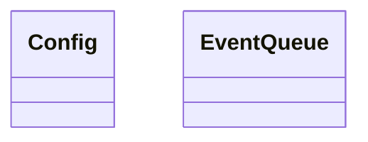
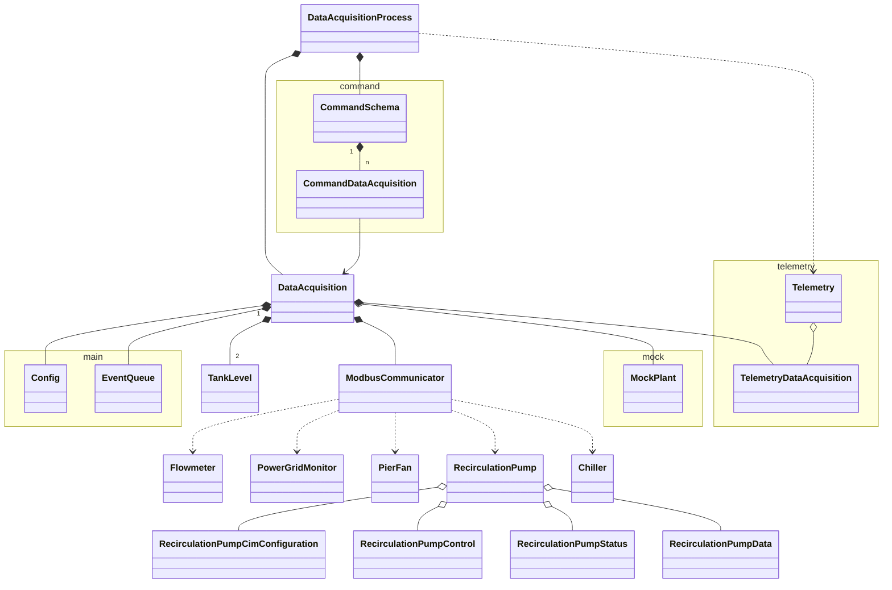
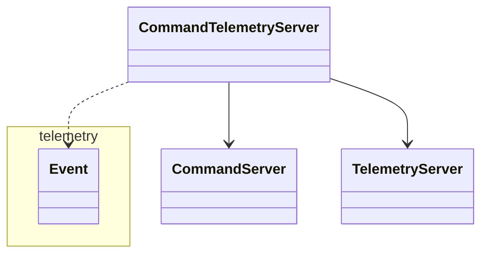
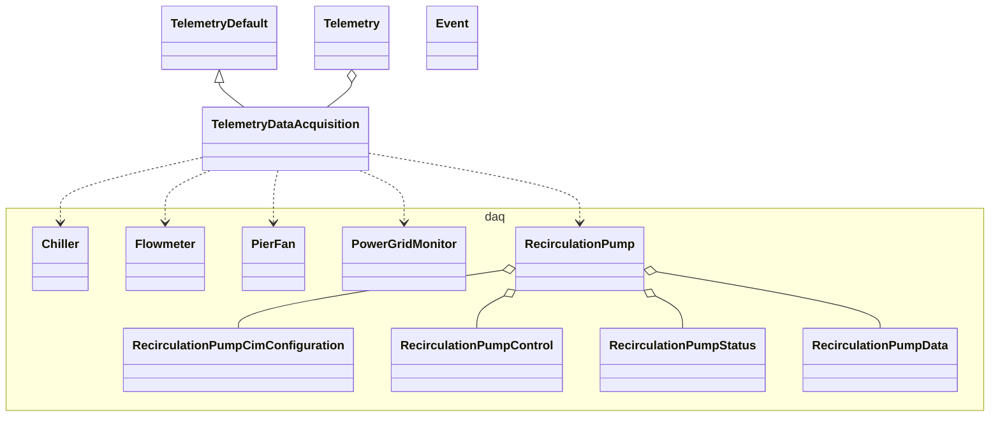
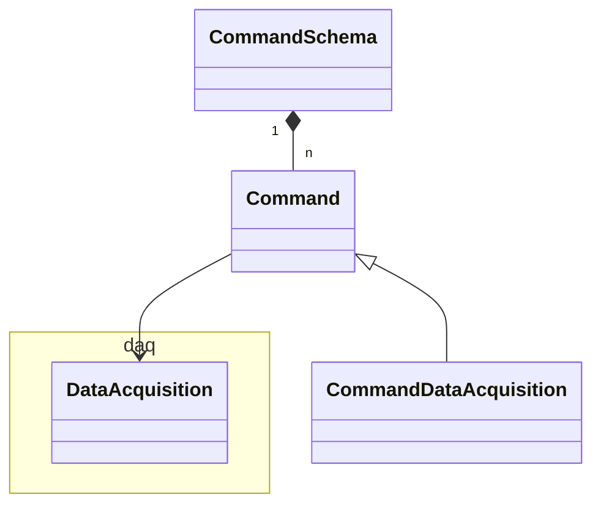
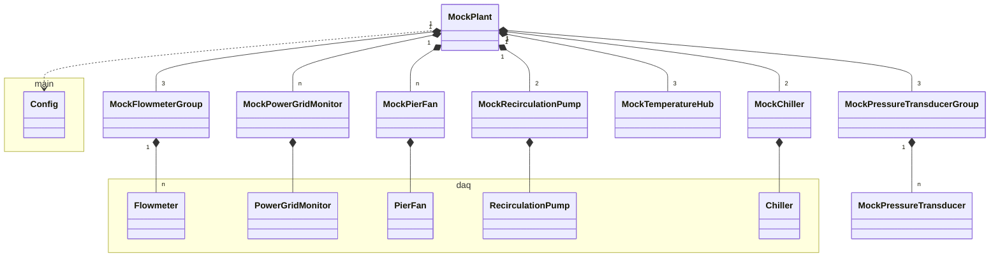

# Class Diagram

There are the following modules in the control system:

- [daq](#daq)
- [interface](#interface)
- [telemetry](#telemetry)
- [command](#command)
- [mock](#mock)

Show the main class diagram below:

## Daq

The [daq](../src/daq/) module implements the data acquisition process:

## Interface

The [interface](../src/interface/) module supports the TCP/IP communication:

## Telemetry

The [telemetry](../src/telemetry/) module supports the telemetry and event:

## Command

The [command](../src/command/) module implements the command factory:

## Mock

The [mock](../src/mock/) module supports the simulation mode:

